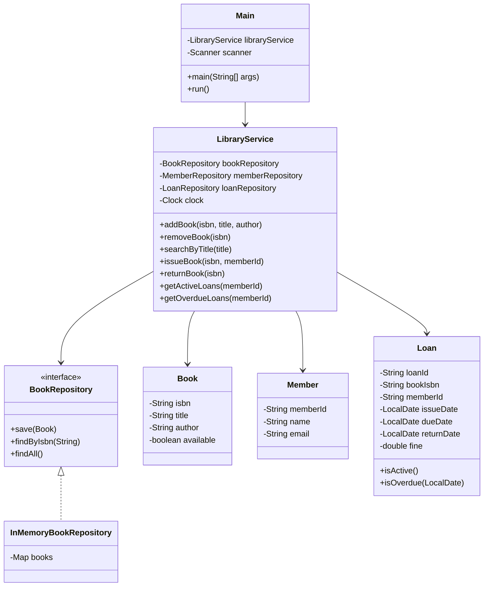
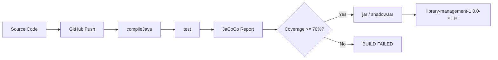

# Architecture and Workflow

## Package Architecture

The application follows a **layered architecture** with clear separation of concerns:

## Build Pipeline

## Layer Descriptions

| Layer          | Package                           | Responsibility                                      |
|----------------|-----------------------------------|-----------------------------------------------------|
| Presentation   | `com.college.library` (Main)      | Console menu, user input/output                     |
| Service        | `com.college.library.service`     | Business logic, validation, loan rules              |
| Repository     | `com.college.library.repository`  | Data access abstraction (interface + in-memory impl)|
| Model          | `com.college.library.model`       | Domain entities (Book, Member, Loan)                |
| Exception      | `com.college.library.exception`   | Custom exception classes for error handling         |

## Design Principles

- **SOLID**: Repository interfaces decouple service from data access (Dependency Inversion)
- **Testability**: Injectable `Clock` for deterministic date-based tests
- **Separation of Concerns**: Each layer has a single, clear responsibility

